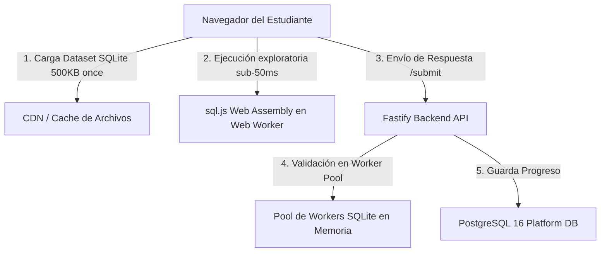

# memory.md — ShopSphere Master Memory Bank

Este archivo es la memoria global del proyecto **ShopSphere**, una plataforma educativa interactiva para aprender SQL. Sirve como la fuente de verdad del estado del proyecto, arquitectura, componentes, estado de contenido de los niveles, correcciones QA y configuración del entorno.

El desarrollo del proyecto está estrictamente alineado con los requerimientos y la filosofía de aprendizaje especificados en los documentos fundacionales del curso localizados en la carpeta de descargas:
*   **PRD de la Plataforma:** `PRD_Plataforma_SQL_ShopSphere.docx` — Define el alcance del MVP (niveles 0-3, Playground, 100+ ejercicios, diagnóstico y gamificación), los requerimientos funcionales y el roadmap de desarrollo.
*   **Descripción y Contexto del Curso:** `Descripcion_Contexto_Objetivos_Curso_SQL.docx` — Establece la filosofía pedagógica (20% teoría, 60% práctica guiada, 20% retos abiertos) orientada a la toma de decisiones empresariales sobre un caso continuo (ShopSphere) para formar analistas junior.

> **Última sincronización con documentos fundacionales y estado del proyecto:** 2026-11-24. Revisión de errores del repositorio ([FIX-07] a [FIX-09]).

---

## 1. Resumen de la Plataforma y Arquitectura

**ShopSphere** enseña SQL usando un dataset de e-commerce ficticio y realista. 

### Decisiones de Arquitectura Críticas
La arquitectura del proyecto está documentada en [arquitectura/decisiones.md](arquitectura/decisiones.md) y se rige por tres prioridades: **seguridad del aislamiento de queries > latencia del Playground < 50ms > costo operacional**.



### Arquitectura de Dos Bases de Datos
El proyecto mantiene dos bases de datos completamente separadas para evitar conflictos comunes:

| Base de Datos | Motor | Contenido / Tablas | Uso en el Sistema |
|---|---|---|---|
| **Plataforma** | PostgreSQL 16 | `users`, `sessions`, `levels`, `exercises`, `user_exercise_progress`, `exercise_attempts`, `certificates` | Backend (Drizzle ORM) para progreso, autenticación y gamificación |
| **Dataset e-commerce** | SQLite | `customers`, `products`, `categories`, `orders`, `order_items`, `returns`, `inventory`, `website_sessions`, `marketing_campaigns`, `payments` | Playground WASM (cliente) + Worker Pool de validación (backend) |

*Nota:* `data/dataset.db` está en el `.gitignore` y se compila a partir de `dataset/generate_seed.py` y `dataset/validate_seed.py` en build time.

---

## 2. Estructura del Repositorio

El proyecto se divide en los siguientes directorios principales:

*   **[arquitectura/](arquitectura/)**: Contiene la bitácora de decisiones arquitectónicas (`decisiones.md`).
*   **[backend/](backend/)**: Código del API REST (Node.js 22 + Fastify + Drizzle ORM).
*   **[frontend/](frontend/)**: Interfaz de usuario y SQL Playground interactivo (Next.js 15 + Tailwind CSS).
*   **[contenido/](contenido/)**: Narrativa de ShopSphere, briefings por nivel y worldbuilding de la empresa.
*   **[modulos/](modulos/)**: Lecciones teóricas y scripts SQL de ejercicios prácticos de los niveles 0 al 8 y el Capstone.
*   **[dataset/](dataset/)**: Generadores del dataset, validador de seeds y plantillas de resultados esperados (`expected-results-*.json`).
*   **[evaluaciones/](evaluaciones/)**: Contiene la evaluación diagnóstica inicial del estudiante (`diagnostico.md`).
*   **[qa/](qa/)**: Informes de calidad (QA) y correcciones aplicadas a lecciones y ejercicios.
*   **[scripts/](scripts/)**: Automatización de setup para Windows (PowerShell) y Linux/macOS (bash).
*   **[monitoring/](monitoring/)**: Configuración del stack de monitoreo (Prometheus + Grafana).

---

## 3. Filosofía Pedagógica y Diseño del Curso (Fuente: Documentos Fundacionales)

### Identidad del Programa
*   **Nombre oficial:** SQL para Análisis de Datos: De Principiante a Analista Profesional
*   **Duración estimada:** 55–60 horas totales
*   **Distribución metodológica:** 20% teoría · 60% práctica guiada · 20% retos abiertos
*   **Rol del estudiante:** Data Analyst de ShopSphere (empresa ficticia de e-commerce)
*   **Meta principal:** Resolver problemas reales de negocio con SQL y construir un portafolio profesional

### Público Objetivo
Principiantes absolutos, estudiantes universitarios, analistas de Excel, profesionales de marketing/negocio, aspirantes a Data Analyst y personas en preparación para entrevistas técnicas.

### Estructura de cada Lección (invariable)
Cada lección del curso debe seguir esta secuencia de 7 pasos:
1. Presentación de un **problema de negocio** real
2. Explicación del **concepto SQL** necesario
3. **Ejemplos guiados**
4. **Práctica interactiva** (SQL Playground)
5. **Reto abierto**
6. **Interpretación de resultados**
7. **Generación de insights** empresariales

### Objetivos Específicos del Programa
Al finalizar, el estudiante debe ser capaz de:
- Comprender la estructura de bases de datos relacionales
- Realizar consultas básicas e intermedias
- Filtrar, ordenar y transformar información
- Construir métricas empresariales relevantes
- Relacionar datos de múltiples tablas (JOINs)
- Aplicar técnicas avanzadas: subconsultas, CTEs, Window Functions
- Analizar comportamiento de clientes y cohortes de retención
- Evaluar campañas de marketing con métricas de rendimiento
- Preparar datasets para BI (Power BI, Tableau)
- Optimizar queries SQL
- Construir dashboards y reportes analíticos
- Comunicar hallazgos y recomendaciones de negocio

### Resultados Esperados al Completar el Curso
- Más de **200 ejercicios** resueltos
- Experiencia en múltiples **casos empresariales reales**
- Un **proyecto final de portafolio** (Capstone)
- Capacidad para **entrevistas técnicas** de SQL
- Conocimientos transferibles a Power BI, Tableau y Python
- Bases para desempeñarse como **Data Analyst Junior**

### Diferenciadores del Programa
- SQL dentro de un **contexto empresarial continuo** (ShopSphere)
- Prioriza la **práctica sobre la teoría**
- **Narrativa ficticia** como hilo conductor de todo el aprendizaje
- **Rutas personalizadas** mediante evaluación diagnóstica
- Integra habilidades **técnicas + analíticas** simultáneamente
- Enfocado en **empleabilidad** real

---

## 4. Requerimientos Funcionales y No Funcionales (Fuente: PRD)

### Requerimientos Funcionales
| ID | Descripción |
|---|---|
| RF-01 | Registro e inicio de sesión |
| RF-02 | Gestión de progreso del estudiante |
| RF-03 | Evaluación diagnóstica inicial |
| RF-04 | Editor SQL (Monaco) integrado |
| RF-05 | Ejecución segura de consultas (WASM + Worker Pool) |
| RF-06 | Corrección automática de ejercicios |
| RF-07 | Sistema de pistas (hints) |
| RF-08 | Gestión de proyectos por nivel |
| RF-09 | Certificados por módulo y certificado final |
| RF-10 | Dashboard de progreso del estudiante |

### Requerimientos No Funcionales
| ID | Descripción |
|---|---|
| RNF-01 | Tiempo de respuesta < 2 segundos (Playground < 50ms en cliente) |
| RNF-02 | Diseño responsive (mobile + desktop) |
| RNF-03 | Disponibilidad 99.5% |
| RNF-04 | Escalabilidad para miles de usuarios simultáneos |
| RNF-05 | Seguridad y aislamiento de consultas (WASM en browser) |
| RNF-06 | Compatibilidad móvil y escritorio |

### Roadmap de Fases (PRD)
| Fase | Contenido |
|---|---|
| **Fase 1** | Fundamentos y Playground |
| **Fase 2** | Contenido Niveles 0–3 |
| **Fase 3** | Contenido Niveles 4–6 |
| **Fase 4** | Capstone |
| **Fase 5** | Certificaciones y gamificación |

### Métricas de Éxito del Producto
- Tasa de finalización del curso
- Tiempo promedio por módulo
- Porcentaje de ejercicios completados
- Conversión a certificado
- Finalización del Capstone
- Satisfacción del usuario

---

## 5. Estado de los Niveles y Contenido del Curso

El currículum del curso consta de 9 niveles (0-8) y un proyecto integrador Capstone:

| ID | Nivel | Contenido Teórico | Ejercicios Prácticos | Tablas Desbloqueadas | Estado QA / Publicación |
|---|---|---|---|---|---|
| **0** | Fundamentos | [leccion-01.md](modulos/nivel-00-fundamentos/leccion-01.md) | N/A (conceptual) | Ninguna | Aprobado / Publicado |
| **1** | Exploración | [leccion-01.md](modulos/nivel-01-exploracion/leccion-01.md) a [leccion-04.md](modulos/nivel-01-exploracion/leccion-04.md) | [ejercicios-nivel-01.sql](modulos/nivel-01-exploracion/ejercicios-nivel-01.sql) (20) | `customers`, `categories`, `products` | Aprobado con obs. / Publicado |
| **2** | Métricas | [leccion-01.md](modulos/nivel-02-metricas/leccion-01.md) a [leccion-04.md](modulos/nivel-02-metricas/leccion-04.md) | [ejercicios-nivel-02.sql](modulos/nivel-02-metricas/ejercicios-nivel-02.sql) (25) | `+ orders` | Aprobado con obs. / Publicado |
| **3** | JOINs | [leccion-01.md](modulos/nivel-03-joins/leccion-01.md) a [leccion-04.md](modulos/nivel-03-joins/leccion-04.md) | [ejercicios-nivel-03.sql](modulos/nivel-03-joins/ejercicios-nivel-03.sql) (25) | `+ order_items` | Aprobado con obs. / Publicado |
| **4** | Clientes | [leccion-01.md](modulos/nivel-04-clientes/leccion-01.md) a [leccion-04.md](modulos/nivel-04-clientes/leccion-04.md) | [ejercicios-nivel-04.sql](modulos/nivel-04-clientes/ejercicios-nivel-04.sql) (25) | `+ returns` | Aprobado con obs. / Publicado |
| **5** | Avanzado | [leccion-01.md](modulos/nivel-05-avanzado/leccion-01.md) a [leccion-04.md](modulos/nivel-05-avanzado/leccion-04.md) | [ejercicios-nivel-05.sql](modulos/nivel-05-avanzado/ejercicios-nivel-05.sql) (25) | `+ inventory` | Aprobado / Publicado |
| **6** | Analítica | [leccion-01.md](modulos/nivel-06-analitica/leccion-01.md) a [leccion-04.md](modulos/nivel-06-analitica/leccion-04.md) | [ejercicios-nivel-06.sql](modulos/nivel-06-analitica/ejercicios-nivel-06.sql) (25) | `+ marketing_campaigns` | Aprobado (correcciones críticas hechas) / Publicado |
| **7** | BI | [leccion-01.md](modulos/nivel-07-bi/leccion-01.md) a [leccion-04.md](modulos/nivel-07-bi/leccion-04.md) | [ejercicios-nivel-07.sql](modulos/nivel-07-bi/ejercicios-nivel-07.sql) (25) | `+ website_sessions` | Aprobado con obs. / Publicado |
| **8** | Profesional | [leccion-01.md](modulos/nivel-08-profesional/leccion-01.md) a [leccion-04.md](modulos/nivel-08-profesional/leccion-04.md) | [ejercicios-nivel-08.sql](modulos/nivel-08-profesional/ejercicios-nivel-08.sql) (25) | `+ payments` | Aprobado / Publicado |
| **Capstone** | Proyecto Final | [README.md](modulos/capstone/README.md) y [capstone-brief.md](contenido/capstone-brief.md) | `parte-01-exploracion.sql` a `parte-05-dashboard-ejecutivo.sql` (25) | Todas las tablas del curso | Aprobado / Publicado |

---

## 6. Estado de los Componentes de Software

### Backend (Node.js 22 + Fastify)
*   **Playground Engine**: Gestiona un pool de Worker Threads de Node.js. Cada worker corre una base SQLite efímera en memoria.
*   **Validación de Queries**: Compara los resultados de la query del alumno con la de referencia en tres modos (`exact_ordered`, `exact_unordered`, `schema_match`).
*   **Autenticación**: JWT con refresh token rotation + guardado de sesiones activas (`sessions`).
*   **Diagnostic Module**: Implementa la evaluación diagnóstica GET `/diagnostic` (24 preguntas) y POST `/diagnostic/submit` que ejecuta las preguntas en el Worker Pool y calcula el nivel recomendado.
*   **Observabilidad**: prom-client integrado que expone GET `/metrics` para Prometheus, reportando latencias HTTP y estado del pool de Workers. Health Check enriquecido en GET `/health`.
*   **Documentación API**: Swagger UI integrado en `/docs` y JSON OpenAPI expuesto en `/docs/json`.

### Frontend (Next.js 15)
*   **Playground interactivo**: Editor SQL basado en Monaco Editor. Corre `sql.js` (WebAssembly) en un Web Worker en el cliente (cero latencia de red para la exploración).
*   **Sistema de Gamificación**:
    *   `XPBar`: Indica nivel y nivel de XP actual (bronce/plata/oro/diamante).
    *   `XPGain`: Toast animado que indica XP ganada con barra de conteo.
    *   `StreakBadge`: Racha del estudiante (fuego si >= 3 días).
    *   `ExerciseFeedback`: Animaciones CSS puras de confetti e información de errores.
*   **Layout y Rutas**: Sidebar responsivo para desktop y Bottom Navigation para mobile. AuthGuard global en `AppLayout`.

---

## 7. Timeline de Correcciones QA Críticas Recientes

A continuación se detallan las correcciones aplicadas entre junio y noviembre de 2026:

*   **[CRIT-N7-01] Vista `v_clientes_perfil` (Nivel 7)**: Se resolvió una multiplicación silenciosa de filas en el triple JOIN de la vista original. Se refactorizó usando CTEs pre-agregadas para evitar inflación en la suma de ingresos (`revenue_total`).
*   **[CRIT-01] Diagnóstico**: Corrección de la pregunta 15 para usar la respuesta con el JOIN correcto `returns -> orders -> customer_id` y evitar columnas inexistentes.
*   **[CRIT-05] Seed y expected-results**: Modificados los productos inactivos (`product_id` 37, 47, 51, 75) para corregir fallos en el Nivel 1.
*   **[CRIT-07 / 08 / 09] Nivel 4**: Corregidos los errores y referencias inválidas a columnas inexistentes (ej. `orders.country` y SUMs incorrectas sobre LEFT JOINs de returns).
*   **[CRIT-N6-01 / N6-02 / N6-03] Nivel 6**: Refactorizadas las consultas de cohortes, LTV (usando cálculo específico en SQLite) y ranking temporal mensual para evitar queries erróneas.
*   **[CRIT-06] Integración Nivel 6**: Se modificó la query de expected results en el ejercicio 12 del Nivel 6 para evitar uso prematuro de la tabla `payments` usando `orders.status = 'cancelled'` como proxy.
*   **[IMP-N8-01 a 04] Nivel 8**: Normalizados los nombres de métodos de pago en el seed (`credit_card`, `bank_transfer`, `paypal`, `crypto`) y corrección de secuencias ACID (`BEGIN...ROLLBACK` sin commits dobles).
*   **[FIX-01] Mapeo de Tablas en el Diagnóstico**: Se implementaron vistas en español (`clientes`, `pedidos`, `resumen_clientes`) en el SQLite local del cuestionario diagnóstico para posibilitar la ejecución real de consultas del estudiante sobre el esquema en inglés de `ShopSphere`.
*   **[FIX-02] Explicación en Lenguaje Natural del Diagnóstico**: Se incorporó un sistema de banner con descripciones cortas (`getQuestionSummary`) de los resultados en lenguaje natural al ejecutar consultas exitosas en el diagnóstico.
*   **[BUG-01] Bloqueo de Radix Slot en Button**: Se corrigió un cuelgue general en el componente de UI `Button` al utilizar `asChild={true}`, aislando el render del spinner `loading` cuando se re-direcciona el renderizado al `Slot` de Radix.
*   **[BUG-02] Validación de Parámetros de Ruta (Zod/Fastify)**: Se solventaron errores de tipado Zod (`Expected string, received number` y `"Level ID must be a positive integer"`) en los esquemas de parámetros de `levels` y `certificates` en el backend, admitiendo coerción y IDs no negativos para soportar el Nivel 0.
*   **[FEAT-01] Volver a evaluar (Re-diagnóstico)**: Se habilitó la opción en el dashboard para volver a realizar el cuestionario de diagnóstico. Se modificó el servicio `saveResult` en el backend para permitir la actualización bidireccional del nivel recomendado en la base de datos (sea mayor o menor al nivel anterior), asegurando que el nuevo resultado se aplique y muestre en el perfil del usuario.
*   **[FIX-03] Nivel 0 (Fundamentos SELECT)**: Se corrigió el bug de parseo de soluciones (CRLF en Windows `\r\n`) mediante una lógica de bloque combinado en `backend/src/scripts/seed-exercises.ts`. Se generó el archivo `expected-results-nivel-00.json` consultado desde SQLite y se sincronizaron las consultas de ejercicios con el dataset real de e-commerce (capitalización de segmentos y nombres de canales). Además, se resolvió el bug de serialización en `levels.routes.ts` que vaciaba la lista de ejercicios de un nivel, y se corrigió el modo `exact_unordered` de `validation.service.ts` para que admita comparación por subconjunto (cuando `sample_rows` contiene una muestra reducida y ligera de filas).
*   **[FEAT-02] Integración de Lecciones Teóricas**: Se implementó una interfaz de lectura de lecciones dentro del detalle de cada nivel (`/niveles/[id]`). El backend ahora escanea de forma dinámica los archivos Markdown (`leccion-*.md`) de la carpeta de módulos correspondiente, extrae sus títulos y sirve el contenido. En el frontend, se instaló la librería `marked` para parsear el contenido y se diseñó un visualizador premium de doble columna con soporte responsivo y formateado semántico mediante la clase `prose` de `@tailwindcss/typography`.
*   **[INSP-01] Inspección de Antigravity (2026-06-04)**: Se realizó una inspección completa del proyecto. Se verificó el correcto funcionamiento de los tests unitarios (`vitest run` exitoso en todos los servicios con mocks de DB y Redis). Se comprobó el tipado estático del frontend con `tsc --noEmit` sin errores. Se identificó y documentó que los tests de integración requieren que Docker esté activo (en esta inspección el servicio de Docker daemon no estaba iniciado y arrojó fallo de conexión pipe/npipe).
*   **[FEAT-03] Remoción de Navegación entre Ejercicios/Unidades (2026-06-04)**: A petición del usuario, se eliminaron por completo del frontend los controles de navegación Anterior/Siguiente agregados previamente en la vista del playground de ejercicios y los botones de paginación entre lecciones en la vista de detalle de nivel, retornando al diseño original del curso.
*   **[INSP-02] Inspección de Antigravity (2026-06-05)**: Se realizó una inspección completa del proyecto. Se verificó el correcto funcionamiento de los tests unitarios del backend (50 de 75 tests exitosos, correspondientes a servicios, quedando 25 de integración pendientes por inactividad de Docker local). Se validó el tipado estático del backend (`npm run typecheck`) y frontend (`npm run type-check`) con éxito y sin errores. Se configuró el linter del frontend creando el archivo `.eslintrc.json`, el cual arrójó advertencias y errores de accesibilidad/enlace (uso de etiquetas `<a>` en lugar de `<Link>` de Next.js, y entidades HTML sin escapar en `HintPanel.tsx`). El linter del backend finalizó con 0 advertencias/errores.
*   **[FIX-04] Sincronización e Integración de Niveles 6-9 y Corrección de Lint/Typecheck (2026-06-05)**: Se completó la modificación de `seed-exercises.ts` para integrar los niveles 6, 7, 8 y Capstone (Nivel 9), añadiendo soporte de múltiples archivos SQL y un parser específico para Capstone. Se corrigió un error de ESLint en el backend relativo a template literals. En el frontend, se reemplazaron todas las etiquetas `<a>` internas por `<Link>` de Next.js para SPA, logrando pasar `npm run lint` y `npm run type-check` con 0 errores y warnings.
*   **[BUG-03] Corrección de Consola SQL en Diagnóstico (2026-06-05)**: Se solucionaron fallos en la consola SQL del cuestionario de diagnóstico: (1) Se migró la carga de `sql.js` para usar la versión local del archivo WASM (vía `locateFile: (file) => `/${file}``) en lugar de la CDNJS, evitando bloqueos por CORS/seguridad. (2) Se copió el archivo `sql-wasm.wasm` local a `sql-wasm-browser.wasm` en el directorio `public/` para resolver el error 404 que arroja el empaquetador del navegador al buscar este recurso. (3) Se pre-pobla el editor con el `sqlPlaceholder` al entrar a preguntas SQL, evitando que esté en blanco y que la plantilla se borre al editar. (4) Se agregó un guard `loadingRef` y se cambió el array de dependencias de `useSQLite` a `[]` para solventar una recarga infinita en caso de fallo de carga de la base de datos y evitar colisiones de montado doble en React StrictMode.
*   **[DEBUG-01] Exposición de Errores de BD en UI Diagnóstico (2026-06-05)**: Se modificó la interfaz para pasar la variable `dbError` a `SqlEditorQuestion` y pintar en pantalla el mensaje técnico detallado de la excepción cuando la base de datos no logre cargarse (`✕ Error al cargar DB (error_detail)`), lo cual permitió identificar el 404 del recurso `sql-wasm-browser.wasm` y diagnosticar rápidamente el fallo.
*   **[BUG-04] Solución al dataset atascado en "Cargando dataset..." (2026-06-05)**: Se resolvió el cuelgue en la inicialización de la base de datos SQLite (tanto en el diagnóstico como en el Playground principal). Bajo la directiva de seguridad global `Cross-Origin-Embedder-Policy: require-corp` configurada en `next.config.ts`, el navegador bloqueaba la carga de los subrecursos WebAssembly (`sql-wasm.wasm` y `sql-wasm-browser.wasm`) al carecer del encabezado `Cross-Origin-Resource-Policy` adecuado. Se añadió la directiva `Cross-Origin-Resource-Policy: same-origin` de manera global (`/(.*)`) para permitir la carga sin restricciones de los archivos de recursos y se reinició el contenedor del frontend, solucionando el bloqueo por completo.
*   **[FEAT-04] Navegación Secuencial de Ejercicios en la Unidad (2026-06-05)**: Se implementó la navegación secuencial SPA entre ejercicios de un mismo nivel. Al resolver correctamente un ejercicio, el botón "Siguiente ejercicio" redirige directamente al siguiente `id` de ejercicio del nivel en orden de `order_index`. Si es el último, regresa a la vista general de la unidad/nivel. Se implementó una lógica de reseteo completo de estados en `page.tsx` y `PlaygroundContainer.tsx` al cambiar de `exerciseId`, evitando filtración o persistencia errónea de datos del ejercicio anterior (como la query previa, pistas reveladas e intentos fallidos) sin necesidad de reiniciar la base de datos WASM local.
*   **[FIX-05] Separación de Pistas e Instrucciones en Seeder (2026-06-05)**: Se corrigió un bug en `parseNivel00File` dentro de `seed-exercises.ts` que provocaba que las líneas correspondientes a pistas (`PISTAS:`) fueran capturadas por error como parte del bloque de instrucciones del ejercicio. Se implementó una cláusula de escape en el bucle del parser para detener el procesamiento de la pregunta cuando se encuentre un marcador de pistas o del editor. Se regeneró la base de datos de ejercicios con la siembra corregida, forzando a que las pistas solo se revelen mediante el desbloqueo por XP en el frontend.
*   **[FIX-06] Garantía de Pista "Casi la solución" (2026-06-05)**: Se detectó que la interfaz requería exactamente 3 pistas (Conceptual, Sintáctica, Casi la solución), pero los archivos de ejercicios usualmente contenían solo 2 pistas, impidiendo que el último slot se llenara y provocando que el tooltip/texto incitara a revisar la pista "Casi la solución" cuando esta no existía. Se desarrolló un enmascarador estructurado de queries de referencia en `seed-exercises.ts` (`generateAlmostSolutionHint`) y una función para normalizar todas las colecciones a exactamente 3 pistas (`ensureThreeHints`). Se re-sembró la base de datos de ejercicios con la tercera pista "Casi la solución" generada para todos los ejercicios.
*   **[INSP-03] Inspección de Antigravity (2026-06-09)**: Se realizó una inspección completa del proyecto. Se verificó el correcto funcionamiento de los tests unitarios del backend (50 de 75 tests de servicios exitosos; 25 tests de integración quedan pendientes debido a la inactividad local de los contenedores Docker de Postgres y Redis). Se validó el tipado estático del backend (`npm run typecheck`) y frontend (`npm run type-check`) con éxito y sin errores. El linter del frontend finalizó con 0 advertencias/errores. El linter del backend arrojó 6 errores de promesas flotantes (`@typescript-eslint/no-floating-promises`) en el controlador de Google OAuth (`auth.controller.ts`), que fueron corregidos al retornar adecuadamente las respuestas asíncronas de Fastify, resultando en 0 advertencias/errores de lint en la posterior ejecución.
*   **[INSP-04] Inspección de Antigravity (2026-06-20)**: Se realizó una inspección completa del proyecto. Se validó el tipado estático (`npm run typecheck` en backend y `npm run type-check` en frontend) resultando en 0 errores. Se ejecutaron los tests unitarios del backend (73 unitarios exitosos; tests de integración con timeout debido a inactividad local del daemon de Docker). Se corrigieron 9 errores de linter en el backend (8 por promesas flotantes en el hook `onSend` de `app.ts` usando el operador `void`, y 1 por importación de tipos en `certificates.service.test.ts` moviéndolo a nivel superior), logrando 0 advertencias/errores de lint en ambos frontend y backend.
*   **[FIX-07] Revisión de errores del repositorio (2026-11-24, commit `7b531fa`)**: (1) El validador del playground rechazaba todo lo que no fuera una sola SELECT, así que los ejercicios de vistas, EXPLAIN y transacciones de N7, N8 y Capstone no se podían aprobar (ni obtener su certificado). Ahora cada envío corre en una copia del dataset en memoria dentro de una transacción que siempre se revierte (ATTACH, PRAGMA y VACUUM siguen bloqueados). (2) Los ejercicios que consultan una vista creada en otro ejercicio (N7 EJ14–22) reciben ese `CREATE VIEW` en `expected_result_json.setup_sql`. (3) Índice en `payments(order_id)` y `ANALYZE` en el dataset: 4 soluciones pasaban el límite de 5 s. (4) La validación compara contra todas las filas (antes solo 1000). (5) Notas de dialecto SQLite en 8 lecciones que enseñaban `DATE_TRUNC`/`EXTRACT`/`INTERVAL`. (6) Desempate por `return_id` en N4 EJ16. (7) Seeder: rutas, cabeceras de ejercicios con sufijo, solución correcta en Capstone EJ20 y modos `manual_review`/`volatile_date_dependent` → `schema_match`. (8) Dependencias sin vulnerabilidades altas o críticas (Next 15.5.29, zod 4, drizzle 0.45, nodemailer 10, vitest 5, better-sqlite3 12). (9) CI: lockfiles versionados, script `type-check`, credenciales de CI sin secrets, `init.sql` sin `\c shopsphere`. Resultado: 240/240 ejercicios validan y 115 tests pasan.
*   **[FIX-08] Imágenes Docker (2026-11-24, commit `f6de4e3`)**: Imagen base `node:22.23.4-alpine3.24` (Alpine 3.21 ya no tenía soporte y traía OpenSSL vulnerable), `apk upgrade` y sin npm/yarn/corepack en la imagen final (traían `tar` con CVE crítico). Trivy en verde.
*   **[FIX-09] Tests de integración inestables (2026-11-24, commit `c169839`)**: Los archivos de integración corrían en paralelo y cada uno hacía `TRUNCATE` sobre la misma base, borrando datos del otro a mitad de un test. Ahora corren uno a la vez (`fileParallelism: false`). Además, la opción `skip` del rate limit global no existe en `@fastify/rate-limit`; se reemplazó por un `max` alto solo en tests. Primer run del CI completo en verde.


---

## 8. Próximos Pasos y Tareas Pendientes

1.  ~~**Publicar Niveles 4 al 8 y Capstone**~~: Hecho. Todos los niveles (0–9) tienen `is_published = true` en `scripts/init.sql` y en el seeder.
2.  **Evaluaciones Formales**: Desarrollar evaluaciones de final de nivel para los niveles 1 al 8.
3.  ~~**Optimizaciones Opcionales**~~: Hecho. La nota de modelo de atribución está en `nivel-06-analitica/leccion-01.md` y las notas de dialecto SQLite están en los Niveles 1, 2, 3, 5 y 6 ([FIX-07]).

---

## 9. Instrucciones para Arrancar el Proyecto

### Levantar Todo el Entorno Local
```bash
docker-compose up -d
```
*Esto iniciará el Frontend (http://localhost:3000), Backend API (http://localhost:3001) y Adminer (http://localhost:8080).*
*(Nota: Requiere que el daemon de Docker esté activo).*

### Poblar Ejercicios en la DB
```bash
docker exec shopsphere-backend npm run seed:exercises
```

### Ejecutar Tests Unitarios

**Localmente (sin Docker):**
```bash
# Backend (en la carpeta backend/)
# Si la política de ejecución de PowerShell bloquea scripts .ps1, usar:
cmd /c npm run test

# Frontend (en la carpeta frontend/)
cmd /c npm run type-check
```

**Vía Docker:**
```bash
# Backend
docker-compose exec backend npm run test
# Frontend
docker-compose exec frontend npm run type-check
```

*(Nota: Los tests de integración en la carpeta `src/integration/` del backend requieren que PostgreSQL y Redis estén levantados en sus puertos locales estándar).*
